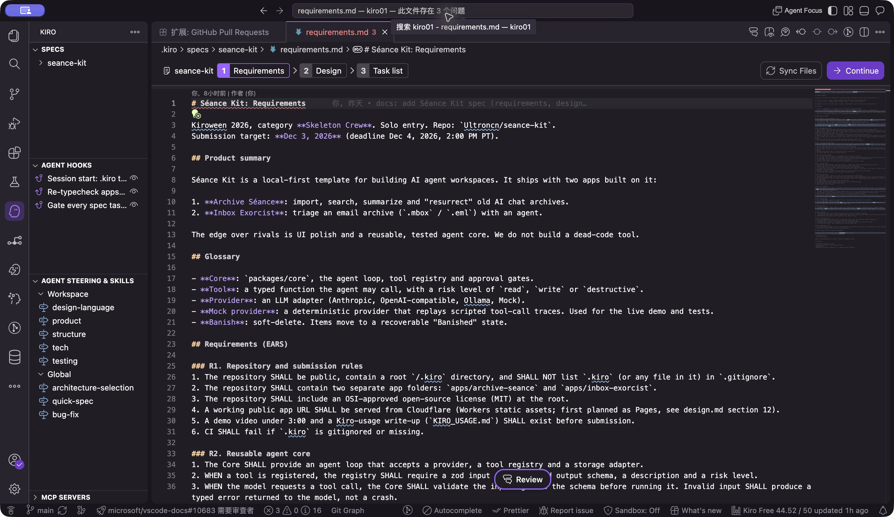
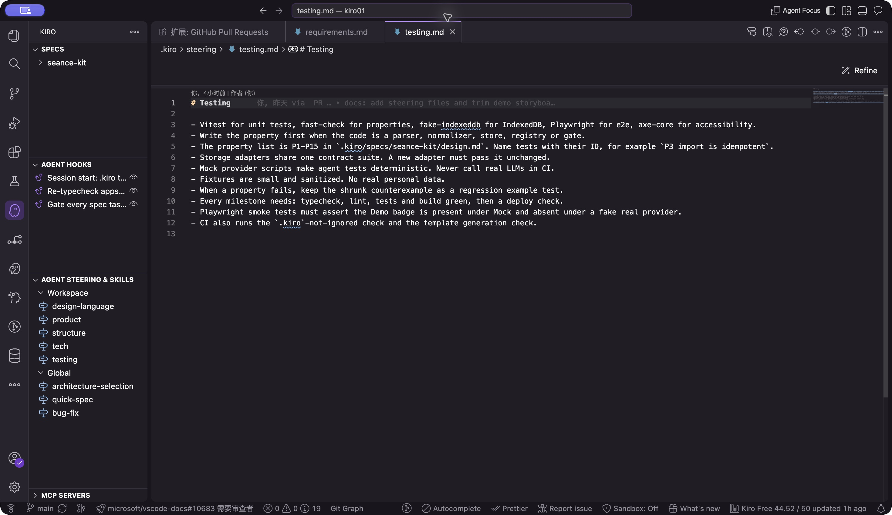
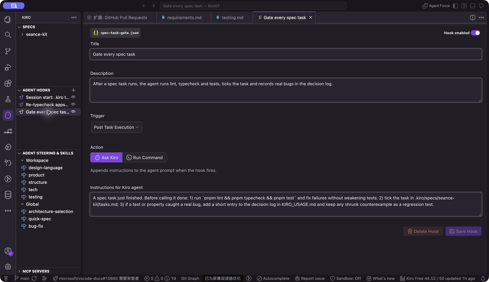
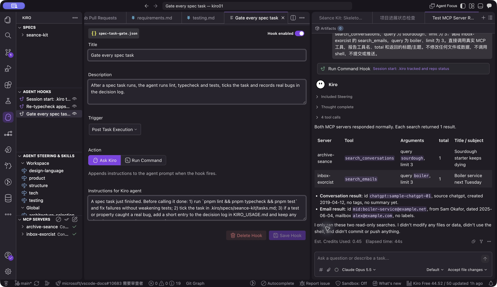
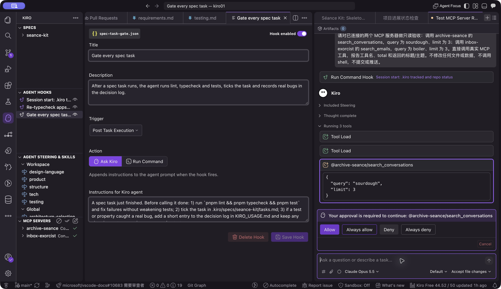
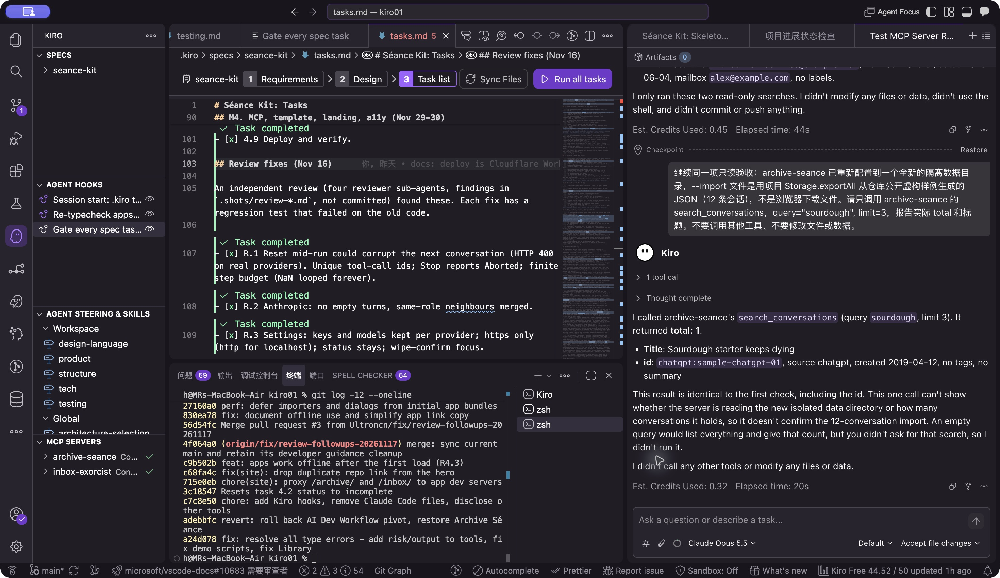
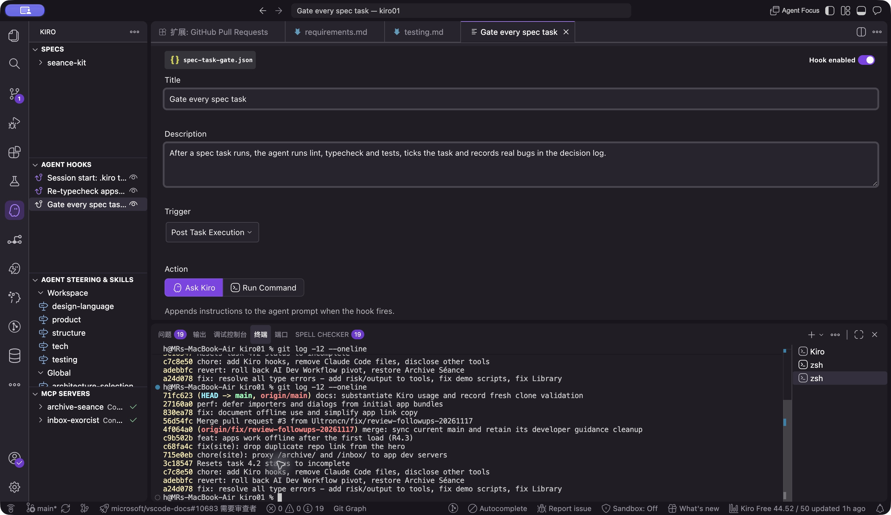
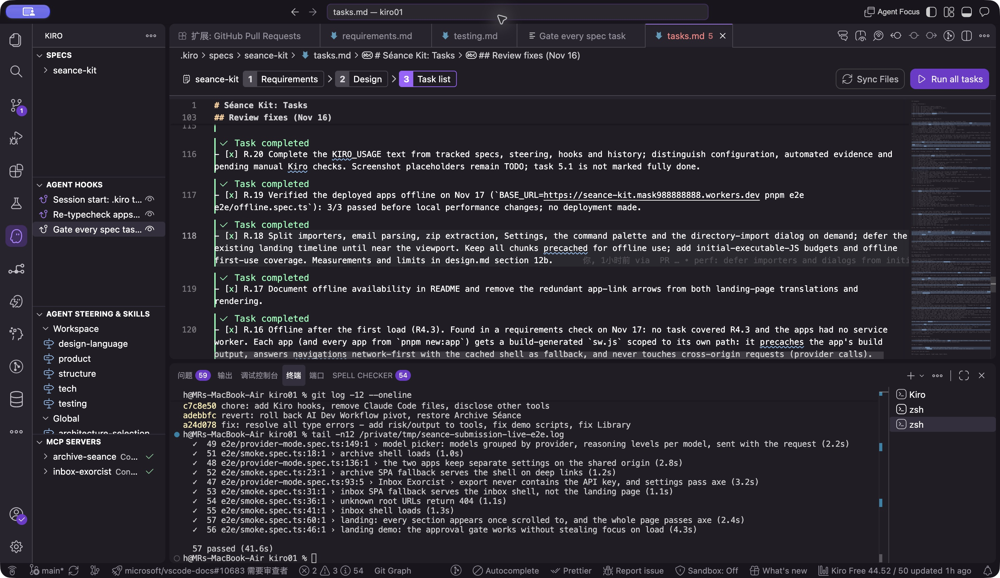

# How we used Kiro

Séance Kit is a Kiroween Skeleton Crew entry: a reusable local-first agent template, demonstrated by Archive Séance and Inbox Exorcist. This write-up follows the tracked specs, steering, hooks, implementation and Git history through Nov 17, 2026. Actual Kiro captures from the Nov 17 acceptance session are included below; their captions distinguish configuration from observed execution.

The earlier project notes attribute most development and the independent reviews to Kiro. Git establishes the changes and their order; it does not establish which IDE authored every line or provide a transcript of every agent session. The historical observations below are identified as such. The Nov 17 follow-up, performance changes and this documentation update were done with Codex, as disclosed under Other tools.

## Specs

The spec was committed before the application scaffold: `5fc41b4` added the four files in [.kiro/specs/seance-kit](.kiro/specs/seance-kit/), `b247c63` added steering, and `6cfd931` created the monorepo, shells, CI and smoke tests.

- [requirements.md](.kiro/specs/seance-kit/requirements.md) defines behavior in EARS form. For example, R2.5 requires approval before a write or destructive tool, R3.4 requires the persistent Mock badge, and R4.3 requires offline use after the first load.
- [design.md](.kiro/specs/seance-kit/design.md) turns those requirements into interfaces: `ToolRegistry`, the `Provider` and `Storage` contracts, the event stream and the approval gate. Its property table names P1–P15; P9 checks that non-read tools never run without approval.
- [tasks.md](.kiro/specs/seance-kit/tasks.md) links implementation tasks to requirement IDs. For example, 1.8 implements the approval gate and Banish/undo, while 1.9 names P8–P10 as its checks. The Review fixes section records subsequent corrections instead of hiding them inside checked milestone items.
- [submission.md](.kiro/specs/seance-kit/submission.md) is a submission plan, including a 2:45 storyboard. It is not evidence that a video was recorded or that the entry was submitted.

A useful correction came from checking the requirements again: R4.3 existed, but no task covered it and the apps had no service worker. `c9b502b` added scoped build-generated workers and offline e2e tests, recorded as R.16. Each worker precaches its own app output and falls back to that app's shell on offline navigation. The requirement led to both an implementation and an explicit test, not just another checked box.



The requirements editor and Kiro spec navigation, captured Nov 17. This is a current view of the tracked spec, not a reconstructed development session.

## Steering

The five files in [.kiro/steering](.kiro/steering/) keep decisions available across tasks. Concrete examples in the repository are:

| File                 | Rule                                                                            | Example of its effect                                                                                                                                                                                                 |
| -------------------- | ------------------------------------------------------------------------------- | --------------------------------------------------------------------------------------------------------------------------------------------------------------------------------------------------------------------- |
| `product.md`         | Local-first; honest demo; no dead-code tooling; the cut list stays cut.         | Both apps use distinct browser databases. Mock runs show a Demo mode badge. Inbox tools create drafts but never send mail. Gmail OAuth, a browser MCP client, semantic search and light mode remain outside the plan. |
| `structure.md`       | App-specific tools stay in apps; core has no React; UI stays presentational.    | `5dd3036` introduced the shared `AgentPanel`, while `16990bb` added `@seance/react` and `useAgentRun`. App-specific approval wording stays in the two `AgentPane` components.                                         |
| `tech.md`            | zod drives tool schemas; secrets stay in IndexedDB and never appear in exports. | The registry derives model and MCP definitions from the same tools. `d0d9f8a` added settings and the reserved `secrets` collection; `packages/storage/test/contract.ts` checks exclusion on each adapter.             |
| `testing.md`         | Name properties P1–P15 and keep shrunk counterexamples.                         | `apps/archive-seance/test/importers.test.ts` retains the P3 example where one batch lists the same chat twice; P1 exercises Markdown bodies containing role markers such as `## User`.                                |
| `design-language.md` | Neutral dark surfaces, shared tokens, visible focus and meaningful motion.      | `db35463` replaced the earlier decorative presentation with the current product UI. `packages/ui/test/tokens.test.ts` checks contrast pairs, and `e2e/kit.spec.ts` checks axe and reduced-motion behavior.            |

The rules also explain why a fix sometimes belongs in a shared package: resetting an agent run is a core/react concern, while parsing a Claude export is an Archive concern. The language switch, resizable shell and timeline are reused; importers and tools remain app-specific.



Kiro lists the five workspace steering files; the open testing rule names P1–P15, shared storage contracts and retained counterexamples. The dependency examples above are supported by the linked code and commits.

## Hooks

Three tracked hook definitions were added in `c7c8e50`. These are their actual configured triggers and actions:

| Hook file                                                                              | Trigger                                                | Configured action and concrete purpose                                                                                                                                                                                                                                    |
| -------------------------------------------------------------------------------------- | ------------------------------------------------------ | ------------------------------------------------------------------------------------------------------------------------------------------------------------------------------------------------------------------------------------------------------------------------- |
| [.kiro/hooks/shared-package-typecheck.json](.kiro/hooks/shared-package-typecheck.json) | `PostFileSave`, matcher `packages/[^/]+/src/.+\.tsx?$` | An agent prompt runs `pnpm typecheck` for the whole repository and fixes errors without weakening types. Saving `packages/ui/src/AgentPanel.tsx`, for example, is meant to check both apps and `templates/app`, not just the package being edited.                        |
| [.kiro/hooks/spec-task-gate.json](.kiro/hooks/spec-task-gate.json)                     | `PostTaskExec`                                         | An agent prompt runs `pnpm lint && pnpm typecheck && pnpm test`, updates the task, and records real test-found bugs in this decision log, retaining any shrunk counterexample. The duplicate-chat P3 regression illustrates the kind of evidence the prompt asks to keep. |
| [.kiro/hooks/session-start-status.json](.kiro/hooks/session-start-status.json)         | `SessionStart`                                         | A command runs `pnpm -s check:kiro && git status --short --branch`, with a 30-second timeout. This exposes ignored guidance or work from another tool before the agent starts editing.                                                                                    |

The history records a limitation rather than uninterrupted automation: `e64b809` marked hooks skipped after the earlier notes reported permission-denied `createHook` attempts; `c7c8e50` later committed the JSON definitions. Their presence proves configuration, not that each hook fired successfully in a particular Kiro session. The Nov 17 Kiro MCP session displayed the SessionStart hook row, but its command output was not inspected; no successful hook exit status is claimed. These are not Git pre-commit hooks, and the task gate itself does not run build or e2e.

[.github/workflows/ci.yml](.github/workflows/ci.yml) separately configures the `.kiro` check, typecheck, lint, tests, build and Playwright, plus generated-template validation. A workflow definition is not a claim that a particular remote CI run passed. In this Codex follow-up the checks were invoked directly; Kiro hooks were not treated as automatically active here.



All three hook names are visible in the sidebar. The open gate shows its actual trigger and prompt, with Hook enabled. This image proves configuration. The MCP session below also displayed a SessionStart Run Command Hook row; its command output and exit status were not inspected.

## MCP

`5ce3e12` added the generic MCP server, app entry points and sample configuration. [packages/mcp-server](packages/mcp-server/) wraps the same `ToolRegistry` used by the browser. Each app currently exposes seven tools, including `undo_banish`; zod supplies the input and output schemas. Risk becomes MCP `readOnlyHint` and `destructiveHint` annotations.

With the user's explicit authorization, [docs/kiro-mcp.json](docs/kiro-mcp.json) was copied to the now-tracked [.kiro/settings/mcp.json](.kiro/settings/mcp.json). Kiro loaded both servers and showed Connected with seven tools each. Task 4.2 was completed by actual calls in Kiro, including an isolated sample-export check.

The Archive entry runs the equivalent of this command from the repository root:

```sh
pnpm --silent exec tsx apps/archive-seance/mcp/main.ts \
  --data .local-data/archive \
  --import apps/archive-seance/public/sample/chatgpt-conversations.json \
  --import apps/archive-seance/public/sample/claude-conversations.json
```

The Inbox entry uses `apps/inbox-exorcist/mcp/main.ts`, `.local-data/inbox` and `apps/inbox-exorcist/public/sample/inbox.mbox`. The data folders are file-backed MCP storage, separate from the browser's IndexedDB. `--import` can instead point to an app export from Settings or a supported raw archive. Re-imports are deduplicated.

The config lists only `search_conversations` and `read_conversation` for Archive, and `search_emails` and `read_email` for Inbox in `autoApprove`. In the tested Accept file changes session, Kiro still requested one-time approval for the reads. This observed behavior is recorded rather than assuming the list suppresses every client prompt. Write and destructive tools are absent from `autoApprove`. MCP risk annotations describe tools; they are not relied upon to establish Kiro's approval behavior. A read-only server mode is also available through `--read-only`.

Concrete automated evidence, distinct from a manual Kiro session:

- `apps/archive-seance/test/mcp.test.ts` imports a ChatGPT sample and calls `search_conversations` with `sourdough`, expecting the starter conversation. It also restores a browser export and starts a real read-only Archive stdio process through Node + tsx from an unrelated working directory, calling `search_conversations` with `regex`. That process test is not the exact pnpm command in the Kiro config.
- `apps/inbox-exorcist/test/mcp.test.ts` imports 18 messages, starts again without duplicating them, calls `search_emails` with `boiler`, and verifies there is no send/forward/SMTP tool.
- `packages/mcp-server/test/server.test.ts` checks derived schemas, annotations, structured results, typed errors and read-only restrictions.

The actual Kiro acceptance request called `search_conversations({query: "sourdough", limit: 3})` and `search_emails({query: "boiler", limit: 3})`. Each returned total 1: “Sourdough starter keeps dying” and “Boiler service next Tuesday”. No MCP writes were called. A second Archive call succeeded after importing a JSON export into a new isolated data directory. That export was produced with the project Storage.exportAll API from public fixtures, not a verified browser download.

Building MCP exposed a real schema bug: zod conversion used the output view, so fields with defaults were incorrectly marked required. `5ce3e12` fixed the conversion; `packages/core/test/registry.test.ts` checks that defaulted inputs are optional. `05b3e8f` added undo support, and `4c78371` serialized MCP calls, locked data folders and batched FileStorage writes.



Both servers are connected and the actual read results contain only repository fictional sample data.



This is a read approval, not evidence of a write approval. Each read was allowed once; Always allow was not selected.



The export check used the project Storage.exportAll API on public sample data. The newly created FileStorage collection was separately inspected and contained 12 conversations; this single query returned one matching record. It does not by itself establish the collection count. The final checked-in configuration was restored to portable sample paths. [Acceptance record](docs/kiro-evidence/mcp-acceptance.json).

## Other tools

The earlier write-up identifies these Claude Code contributions; the commit history preserves their changes and subsequent corrections:

- `2342461` added one-click import, a mouse-only resizable pane layout and `CLAUDE.md`; `48c90d1` fixed syntax errors. `b141b60` then restored the shared shell, added keyboard resizing and P15, and translated and typed the import dialog.
- `520aa4e`, `2654af2`, `5158c8f` and `a24d078` attempted a memory-bank/developer-workflow pivot. `adebbfc` reverted those four changes to restore Archive Séance and the agreed scope. The earlier notes report lint and 11 test failures during that attempt; those historical failures were not reproduced for this write-up.
- `c7c8e50` removed `CLAUDE.md` and `.claude/` and disclosed the other-tool work. `.kiro/` remains the project's tracked guidance.

Codex performed this Nov 17 follow-up after the user supplied the five-task handoff. It checked the newly merged PR #3 (`56d54fc`), added the README/link-copy fix (`830ea78`), ran the three deployed offline tests successfully, and implemented dynamic loading (`27160a0`). It also ran a read-only independent review of the performance patch; no blocking finding was reported, and its budget-sampling observation led to waiting for startup network activity to settle in the test.

The performance patch defers importers, MIME parsing, zip extraction, Settings, the command palette, the directory-import dialog and the existing below-the-fold landing demo. [design.md section 12b](.kiro/specs/seance-kit/design.md#12b-initial-javascript-measured-nov-17-2026) records before/after gzip sizes and the offline-cache tradeoff. App service workers still fetch deferred chunks for offline use, so a smaller startup bundle is not a claim of less total first-visit download traffic.

A fresh local clone of `27160a0` passed `pnpm i --frozen-lockfile`, `pnpm test` (332 tests) and `pnpm build` on Node 24.18.0 / pnpm 9.15.9. Its temporary directory was deleted. This was a new checkout on the same machine, with the existing pnpm cache available, not a clean-machine certification. The source included unpushed local work, so it was cloned from the local repository rather than GitHub.



The history shows merged PR #3, the scope-restoring revert and the Codex follow-up. At capture time local main and origin/main were both 71fc623; the later MCP and evidence commits are local follow-up work.

## Decision log

### Deployment: use a per-app Worker fallback

The earlier deployment record reports Cloudflare error 100324 (“Infinite loop detected in this rule”) for wildcard `_redirects` rewrites. `fd7a2dd` replaced them with [worker/index.js](worker/index.js). A root SPA fallback would send the landing page for app deep links, so the Worker serves the appropriate Archive or Inbox shell in place. `9c15d8e` corrected deep-link behavior and strengthened the e2e assertions to check URL and HTTP status. `scripts/serve-dist.mjs` runs the same fallback implementation for local e2e. See design section 12. After the user authorized pushing the three initial follow-up commits, GitHub CI and Cloudflare deployment passed for 71fc623; this does not imply that later local evidence commits have already deployed.

### Keep keys out of exports, not merely out of the UI

`d0d9f8a` placed provider settings in the reserved `secrets` collection. All three storage adapters exclude it from `exportAll`, and export import rejects a file containing it. `packages/storage/test/contract.ts`, `packages/storage/test/export-file.test.ts` and `e2e/provider-mode.spec.ts` check those boundaries. A hidden password field alone would not have protected a shared export.

### Let properties keep concrete counterexamples

P1 covers Markdown role-marker lines so an exported message containing `## User` does not split into extra messages on re-import. P3 retains a shrunk duplicate-ID batch that previously flipped stored versions on each import. These examples live in `apps/archive-seance/test/importers.test.ts`; `451201d` fixed the duplicate-batch behavior. `a85f310` also stopped yielding after every tiny import: the earlier record says a slow P3 run exposed unnecessary per-import pauses.

For Inbox, `1cada2f` added the unescaped `From ` body-line regression because a well-formed mbox generator had escaped the case away. `e6b841d` replaced the quadratic HTML conversion path; `ea0b73d` tightened separators and made zipped mbox reads use slices. The fixtures and tests, rather than invented mail or a live account, define these cases.

### Share the React bridge, keep the core independent

`16990bb` introduced `@seance/react` with `useAgentRun` for event reduction, approval promises, Stop and Undo. `5dd3036` extracted `AgentPanel`. Both apps and the template consume the same bridge and UI, while domain tools and approval descriptions stay in the app folders. This implements the dependency direction in steering rather than copying each app's agent plumbing.

### Review fixes R.1–R.16

The earlier project notes describe four Kiro reviewer sub-agents covering platform, Archive, Inbox, and UI/tooling. Their `.shots/review-*.md` reports are not tracked, so this document does not reconstruct their prompts or claim a fresh review of those reports. The following tracked fixes and tests are the checkable record. R numbers identify review/follow-up entries, not requirement numbers.

| Entry | Concrete change                                                                                                                                         | Git and verification evidence                                                                                                                       |
| ----- | ------------------------------------------------------------------------------------------------------------------------------------------------------- | --------------------------------------------------------------------------------------------------------------------------------------------------- |
| R.1   | Reset/Stop no longer leave orphan tool results in the next conversation; tool-call IDs are unique and step budgets finite.                              | `17d0b28`; `packages/core/test/agent.test.ts`, `packages/react/test/useAgentRun.test.tsx`.                                                          |
| R.2   | Anthropic conversion drops empty turns and merges neighboring turns of the same role.                                                                   | `e503d12`; `packages/llm/test/providers.test.ts`.                                                                                                   |
| R.3   | Provider forms keep their own keys/models, constrain endpoints and preserve status and wipe-confirm focus.                                              | `0df33ae`; UI settings and review-regression tests.                                                                                                 |
| R.4   | Archive imports retain newer data and annotations, skip zip junk/attachments, and prevent overlapping imports; demo copy stays honest.                  | `1f27a68`, `8fab8ee`; Archive importer and review-regression tests.                                                                                 |
| R.5   | Inbox handles hostile HTML and real mbox boundaries, uses Reply-To, limits zipped imports and refreshes category reads.                                 | `e6b841d`, `ea0b73d`; Inbox importer and review-regression tests.                                                                                   |
| R.6   | Rejected steps retain contrast, decisions keep focus in the timeline, replies are announced, toasts pause on hover and palette matching is predictable. | `9c15d8e`; UI tests, `e2e/archive.spec.ts`, `e2e/keyboard.spec.ts` and axe paths.                                                                   |
| R.7   | Deep links stay at the requested URL, `.kiro` ignore checks use `--no-index`, and CI rejects flaky-only successes.                                      | `2d26a73`, `9c15d8e`, `b535908`; worker/script tests and `e2e/smoke.spec.ts`.                                                                       |
| R.8   | MCP exposes undo, serializes calls and locks its data folder; FileStorage caches and batches writes.                                                    | `05b3e8f`, `4c78371`; MCP and storage tests. Historical timing remains in the R.8 task record, not a new benchmark here.                            |
| R.9   | Typed EN/中文 dictionaries, shared language state and bilingual Mock scripts cover both apps and the site.                                              | `708991b`, `510549a`; i18n tests and `e2e/i18n.spec.ts`.                                                                                            |
| R.10  | Saved profiles, vendor presets and model-list loading replace a single provider form.                                                                   | `28b976f`; LLM settings, UI settings and provider-mode e2e tests.                                                                                   |
| R.11  | Inbox retains mailbox identity, filters by mailbox and documents export-based import.                                                                   | `aa191dc`; `apps/inbox-exorcist/test/mailboxes.test.ts` and the multi-mailbox e2e.                                                                  |
| R.12  | The model menu groups saved providers and reasoning choices; returned reasoning is preserved for follow-up calls.                                       | `f8bf760`; `packages/ui/test/model-picker.test.ts`, provider tests and provider-mode e2e.                                                           |
| R.13  | Providers parse SSE text/reasoning deltas and timelines retain arrived text when stopped.                                                               | `6a8ce47`; LLM/core streaming tests and P13/P14.                                                                                                    |
| R.14  | The redesign uses neutral surfaces, one accent, consistent controls and real product screenshots on the landing page.                                   | `db35463`; tokens tests, `pnpm screenshots`, landing and kit e2e. The screenshot command exists; it was not rerun as part of writing this document. |
| R.15  | Both apps use the shared shell; splitters support keyboard/pointer resizing and saved widths, with typed and translated one-click import.               | `b141b60`; `packages/ui/test/pane-widths.test.ts` (P15) and keyboard e2e.                                                                           |
| R.16  | Apps and generated templates work offline after first load through scoped workers and complete-build precaching.                                        | `c9b502b`; `scripts/vite-offline.test.ts` and `e2e/offline.spec.ts`.                                                                                |

The review record's lesson is specific: a scripted provider can hide real protocol errors, a passing property can miss inputs excluded by its generator, and a test must assert the behavior named in its title. The follow-up merge `56d54fc` added further core, search, storage and Mock regressions; it was included before the Nov 17 checks rather than treated as a separate, unverified branch.



R.16–R.20 are visible above the actual terminal output of the full production suite: 57 passed in 41.6 seconds. The terminal displays a saved test log, not a new test run launched by a hook. The [complete production log](docs/kiro-evidence/production-e2e.log) includes the offline first-use cases; the R.1–R.16 table above links the individual regression evidence.

## Remaining submission evidence

Task 5.1 now includes six categories of actual Kiro captures, with additional MCP approval/export evidence. No screenshot contains a key or private archive. The text and captures distinguish earlier Kiro-attributed work from the Codex closeout, and hook configuration from verified tool execution.

The three initial follow-up commits were pushed with the user's authorization. [GitHub CI for 71fc623](https://github.com/Ultroncn/seance-kit/actions/runs/44009744731) and its Cloudflare deployment passed. On Nov 17, the full suite against the deployed URL passed 57/57 in fresh Playwright contexts, including accessibility, keyboard and offline flows. This is automated clean-browser acceptance, not a claim of a manual private-window session or a real-model call.

Task 1.11 still requires successful real-model acceptance. The owner configured a real OpenAI-compatible profile, but a read-only gpt-6-luna tool prompt returned HTTP 400 about function tools with its reasoning setting on /v1/chat/completions; that model offered no reasoning choices in the app menu. The owner was still adjusting profiles, so no successful real-model run or confirmed code root cause is claimed. The Devpost draft contains the project story, category, links, testing instructions and the three approved public-sample images; video and personal eligibility fields remain incomplete. It has not been submitted and no final eligibility or legal declaration has been accepted. Recording/upload and the real-provider video segment remain open.
